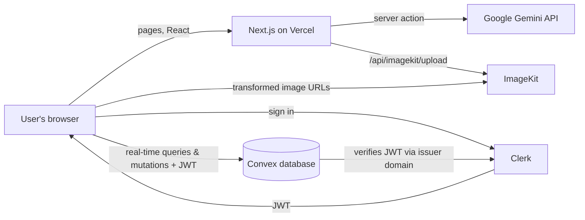
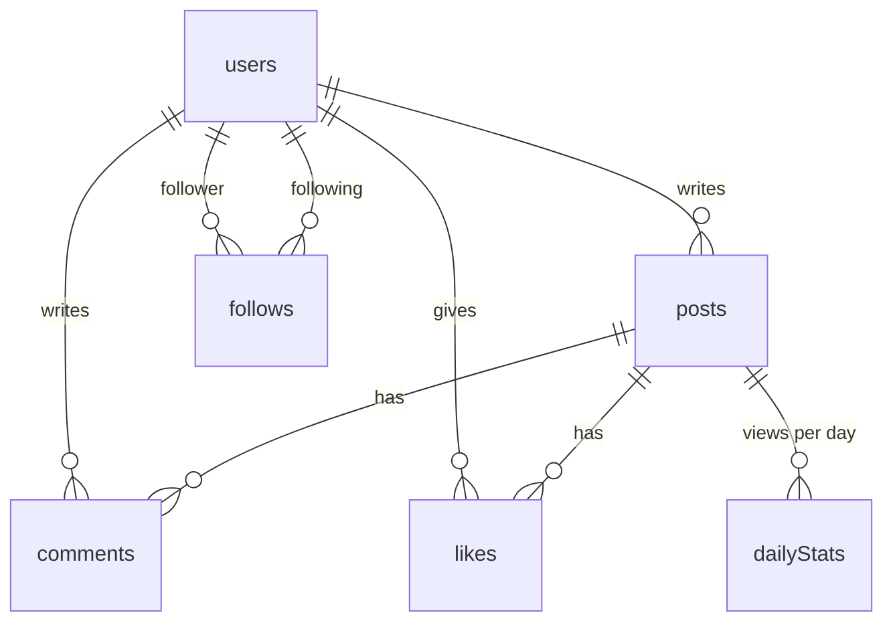
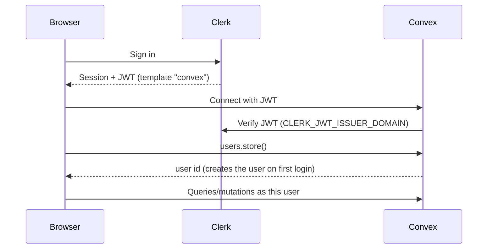

# Creatr — AI Creator Platform: Complete Project Documentation

> Final Year Project · B.Tech Computer Science and Engineering · Invertis University
> Repository: https://github.com/keshrirohan/ai-creator-platform
> Document last updated: 13 November 2026

---

## Table of Contents

1. [Project Overview](#1-project-overview)
2. [Team](#2-team)
3. [Technology Stack](#3-technology-stack)
4. [System Architecture](#4-system-architecture)
5. [Features in Detail](#5-features-in-detail)
6. [Pages and Routes](#6-pages-and-routes)
7. [Database Design (Convex)](#7-database-design-convex)
8. [Backend Functions Reference](#8-backend-functions-reference)
9. [Server Actions and API Routes](#9-server-actions-and-api-routes)
10. [Frontend Components and Hooks](#10-frontend-components-and-hooks)
11. [AI Writing Assistant (Gemini)](#11-ai-writing-assistant-gemini)
12. [Image Upload and Transformations (ImageKit)](#12-image-upload-and-transformations-imagekit)
13. [Authentication Flow (Clerk + Convex)](#13-authentication-flow-clerk--convex)
14. [Developer Usage Bar](#14-developer-usage-bar)
15. [Project Structure](#15-project-structure)
16. [Environment Variables](#16-environment-variables)
17. [Local Setup](#17-local-setup)
18. [Deployment](#18-deployment)
19. [Testing](#19-testing)
20. [Third-Party Service Limits (Free Plans)](#20-third-party-service-limits-free-plans)
21. [Security Notes](#21-security-notes)
22. [Known Limitations and Future Work](#22-known-limitations-and-future-work)
23. [Change Log](#23-change-log)

---

## 1. Project Overview

**Creatr** is a full-stack content creation and publishing platform with a built-in AI writing assistant. It combines a blogging platform with creator-focused social features.

Users can:

- Write posts in a rich text editor, with AI that generates, enhances, expands or simplifies content.
- Upload images and transform them (resize, smart crop, text overlay, background removal).
- Publish posts to a public feed and to a personal profile page at `/<username>`.
- Like, comment on and share posts, and follow other creators.
- Track performance on a dashboard: views, likes, comments, followers and a 30-day views chart.

**Objective:** simplify digital content creation by combining AI writing assistance with a creator community, in one place.

---

## 2. Team

| Member | Role |
|---|---|
| Rohan Keshri | Developer |
| Vansh Gupta | Developer |
| Bhumi Agrawal | Developer |

**Department:** Computer Science and Engineering · **University:** Invertis University · **Type:** Final Year Group Project

*Site footer credit:* "Made with ❤️ by XLR8 Developer".

---

## 3. Technology Stack

| Layer | Technology | Version | Purpose |
|---|---|---|---|
| Framework | Next.js (App Router, Turbopack in dev) | 15.5.29 | Pages, routing, server actions, API routes |
| UI library | React | 19.1.10 | Components |
| Styling | Tailwind CSS | 4.1 | Utility-first styling, dark theme |
| UI components | shadcn/ui on Radix UI, Lucide icons | — | Dialogs, menus, selects, tabs, sliders |
| Rich text editor | react-quill-new | 3.6.0 | Post body editor |
| Database + backend | Convex | 1.25.4 | Real-time database, queries, mutations |
| Authentication | Clerk (`@clerk/nextjs`) | 7.9.26 | Sign up, sign in, sessions, JWTs for Convex |
| AI | Google Gemini (`@google/generative-ai`) | 0.24.1 | Content generation and improvement |
| Media | ImageKit (`imagekit` SDK) | 6.0.0 | Image storage, CDN, URL-based transformations |
| Charts | Chart.js + react-chartjs-2 | 4.6.1 / 5.3.0 | Dashboard daily views chart |
| Forms | React Hook Form + Zod | 7.62 / 4.0 | Form state and validation |
| Notifications | Sonner | 2.0 | Toast messages |
| Dates | date-fns | 4.1 | "2 days ago" formatting |
| Testing | Jest + React Testing Library | 30.5 | Unit and component tests |
| Hosting | Vercel (frontend) + Convex Cloud (backend) | — | Production deployment |

---

## 4. System Architecture



**How the pieces fit:**

- **Next.js** serves the pages. Most pages are client components that talk to Convex directly.
- **Convex** is both the database and the backend. Queries are reactive: when data changes, every open page using it updates automatically, with no polling.
- **Clerk** handles login. The browser gets a Clerk JWT (template name `convex`), and Convex verifies it using `CLERK_JWT_ISSUER_DOMAIN` (see `convex/auth.config.js`).
- **Gemini** is only called from the server (`app/actions/gemini.js`), so the API key never reaches the browser.
- **ImageKit** uploads go through the Next.js API route (`/api/imagekit/upload`), which keeps the private key on the server. Transformations are applied by changing the image URL, with no extra server code.

---

## 5. Features in Detail

### 5.1 Authentication and user profiles
- Sign up and sign in with Clerk at `/sign-in` and `/sign-up`.
- On first login the `useStoreUser` hook calls `users.store`, which creates the user record in Convex (name, email, picture, Clerk token identifier).
- Users choose a **username** in Dashboard → Settings: 3–20 characters, letters, numbers, `_` and `-`, must be unique.
- Dashboard routes (`/dashboard/*`) are protected by Clerk middleware and redirect to sign-in.

### 5.2 Post editor
- **Rich text** with headings, sizes, bold/italic/underline/strike, colours, alignment, links, quotes, code blocks, lists, indents, images and video.
- **Featured image** upload, with change and remove options.
- **Inline images** inserted at the cursor position from the toolbar image button.
- **Post settings** dialog:
  - Category (Technology, Design, Marketing, Business, Lifestyle, Education, Health, Travel, Food, Entertainment)
  - Up to 10 tags (Enter or comma to add)
  - Schedule date and time
- **Validation** (Zod): title required, max 200 characters; content required; max 10 tags.
- **Drafts:** each user has at most one draft. Saving again updates it. In create mode the draft auto-saves every 30 seconds.
- **Publish menu:** "Publish now" or "Schedule for later". In edit mode the button is "Update".

### 5.3 AI writing assistant
- **Generate:** writes a full 800–1200 word post in HTML from the title, category and tags.
- **Enhance / Expand / Simplify:** rewrites the existing content.
- If one Gemini model is busy or rate-limited, it falls back through several models automatically (see [section 11](#11-ai-writing-assistant-gemini)).

### 5.4 Image upload and transformation
- Drag-and-drop or click to upload (JPG, PNG, WebP, GIF, max 10 MB).
- **Free transformations:** aspect ratio (Original, 1:1, 16:9, 4:5, 9:16, Custom), smart crop focus (auto, face, center, top, bottom), and text overlay with font size, colour and position.
- **AI transformations** (use ImageKit AI credits): background removal and drop shadow.
- The modal checks that the transformed image loads before showing it, and explains ImageKit errors such as running out of AI credits.

### 5.5 Public feed (`/feed`)
- **For You** tab: latest published posts.
- **Trending** tab: posts from the last 7 days ranked by `views + likes × 3`.
- **Suggested creators:** users you don't follow yet, who have published posts, ranked by recent activity, then by engagement score (`views + likes × 5 + followers × 10`).
- Signed-in users see a "create post" prompt.

### 5.6 Creator profiles (`/<username>`)
- Avatar, name, @username, join date, follower count and published posts.
- **Follow / Unfollow** button. It's hidden on your own profile, and the server also blocks following yourself.

### 5.7 Post page (`/<username>/<postId>`)
- Featured image, title, author, date, tags and formatted content.
- **Views:** each visit increments the post's view count and that day's view count in `dailyStats`.
- **Likes:** toggle like (signed-in users only); the count updates instantly.
- **Comments:** 1–1000 characters, signed-in users only. The comment author or the post owner can delete a comment.

### 5.8 Dashboard (`/dashboard`)
- Totals for views, likes, comments and followers, with growth percentages.
- A chart of **daily views for the last 30 days**.
- Recent posts, with their comment counts.
- Recent activity: new likes, comments and followers, newest first.

### 5.9 My Posts (`/dashboard/posts`)
- Search by title.
- Filter by status (All, Published, Draft).
- Sort by newest, oldest, most views, most likes, or A–Z.
- Per-post menu: Edit, View Public, Duplicate (not implemented yet), Delete (with confirmation).
- Status badges: Draft, Published, Scheduled.

### 5.10 Followers (`/dashboard/followers`)
- **Followers** and **Following** lists.
- Shows follow-back status, post counts and recent posts, with follow/unfollow buttons.

### 5.11 Landing page (`/`)
- Hero, features grid, "How it works" tabs, stats, testimonials (Rohan Keshri, Vansh Gupta, Pihu Agrawal, shown with initials avatars) and calls to action.
- Signed-in visitors are redirected to `/feed`.

### 5.12 Developer usage bar
- A strip at the top of the site, shown only in development, with live API usage. See [section 14](#14-developer-usage-bar).

---

## 6. Pages and Routes

| Route | File | Access | Description |
|---|---|---|---|
| `/` | `app/page.js` | Public | Landing page |
| `/sign-in`, `/sign-up` | `app/(auth)/…` | Public | Clerk auth screens |
| `/feed` | `app/(public)/feed/page.jsx` | Public | Feed, trending, suggested creators |
| `/[username]` | `app/(public)/[username]/page.jsx` | Public | Creator profile |
| `/[username]/[postId]` | `app/(public)/[username]/[postId]/page.jsx` | Public | Post, likes, comments |
| `/dashboard` | `app/dashboard/page.jsx` | Signed in | Analytics overview |
| `/dashboard/create` | `app/dashboard/create/page.jsx` | Signed in | New post (needs a username) |
| `/dashboard/posts` | `app/dashboard/posts/page.jsx` | Signed in | Manage posts |
| `/dashboard/posts/edit/[id]` | `app/dashboard/posts/edit/[id]/page.jsx` | Signed in | Edit post |
| `/dashboard/followers` | `app/dashboard/followers/page.jsx` | Signed in | Followers and following |
| `/dashboard/settings` | `app/dashboard/settings/page.jsx` | Signed in | Set username |
| `POST /api/imagekit/upload` | `app/api/imagekit/upload/route.js` | Signed in | Upload image to ImageKit |
| `GET /api/dev/usage` | `app/api/dev/usage/route.js` | Dev mode only (404 in production) | Usage data for the dev bar |

Route protection is in `middleware.js` (Clerk middleware; `/dashboard(.*)` requires sign-in).

---

## 7. Database Design (Convex)

Schema file: `convex/schema.js`.

**Deployments:**

| Deployment | Name | URL | Used by |
|---|---|---|---|
| Development | `descriptive-oyster-191` | `https://descriptive-oyster-191.convex.cloud` | `npm run dev` |
| Production | `neighborly-vole-562` | `https://neighborly-vole-562.convex.cloud` | Live Vercel site |

The two databases are separate. Data created locally does not appear on the live site.

### Entity relationships



### Tables

#### `users`
| Field | Type | Notes |
|---|---|---|
| `name` | string | From Clerk |
| `email` | string | From Clerk |
| `tokenIdentifier` | string | Clerk identity, used to find the logged-in user |
| `imageUrl` | string? | Profile picture |
| `username` | string? | Unique, public profile URL |
| `createdAt`, `lastActiveAt` | number | Timestamps (ms) |

Indexes: `by_token`, `by_email`, `by_username`. Search indexes: `search_name`, `search_email`.

#### `posts`
| Field | Type | Notes |
|---|---|---|
| `title` | string | Max 200 characters (client validation) |
| `content` | string | HTML from the editor |
| `status` | `"draft"` \| `"published"` | |
| `authorId` | id → users | |
| `tags` | string[] | Max 10 |
| `category` | string? | |
| `featuredImage` | string? | ImageKit URL (may include transformations) |
| `createdAt`, `updatedAt` | number | |
| `publishedAt` | number? | Set when first published |
| `scheduledFor` | number? | Chosen schedule time |
| `viewCount`, `likeCount` | number | Counters |

Indexes: `by_author`, `by_status`, `by_published`, `by_author_status`. Search index: `search_content` (title).

#### `comments`
| Field | Type | Notes |
|---|---|---|
| `postId` | id → posts | |
| `authorId` | id → users? | |
| `authorName`, `authorEmail` | string / string? | Copied at time of comment |
| `content` | string | 1–1000 characters |
| `status` | `approved` \| `pending` \| `rejected` | Signed-in comments are auto-approved |
| `createdAt` | number | |

Indexes: `by_post`, `by_post_status`, `by_author`.

#### `likes`
| Field | Type |
|---|---|
| `postId` | id → posts |
| `userId` | id → users? |
| `createdAt` | number |

Indexes: `by_post`, `by_user`, `by_post_user`.

#### `follows`
| Field | Type |
|---|---|
| `followerId` | id → users (who follows) |
| `followingId` | id → users (who is followed) |
| `createdAt` | number |

Indexes: `by_follower`, `by_following`, `by_relationship`.

#### `dailyStats`
| Field | Type | Notes |
|---|---|---|
| `postId` | id → posts | |
| `date` | string | `YYYY-MM-DD` (UTC) |
| `views` | number | Views on that day |
| `createdAt`, `updatedAt` | number | |

Indexes: `by_post`, `by_date`, `by_post_date`.

---

## 8. Backend Functions Reference

All in the `convex/` folder. **Q** = query (read, real-time), **M** = mutation (write).

### `users.js`
| Function | Type | Auth | Description |
|---|---|---|---|
| `store` | M | Required | Create the user on first login, or update the name if it changed |
| `getCurrentUser` | Q | Optional | Logged-in user's record, or `null` if not signed in |
| `updateUsername` | M | Required | Validate format, length and uniqueness, then save |
| `getByUsername` | Q | Public | Public profile fields only (no email or token) |

### `posts.js`
| Function | Type | Auth | Description |
|---|---|---|---|
| `create` | M | Required | Create a post, or update the user's existing draft |
| `update` | M | Owner | Update fields; sets `publishedAt` when a draft is first published |
| `getUserDraft` | Q | Optional | The user's single draft |
| `getUserPosts` | Q | Optional | The user's posts, optional status filter |
| `getById` | Q | Public | A post by ID (used by the edit page) |
| `deletePost` | M | Owner | Delete a post |

### `public.js`
| Function | Type | Description |
|---|---|---|
| `getPublishedPostsByUsername` | Q | Published posts for a profile, with pagination (`hasMore`, `nextCursor`) |
| `getPublishedPost` | Q | One published post, checked against the username |
| `incrementViewCount` | M | Increases `viewCount` and that day's `dailyStats` |

### `feed.js`
| Function | Type | Description |
|---|---|---|
| `getFeed` | Q | Latest published posts with author info |
| `getSuggestedUsers` | Q | Creators to follow, ranked |
| `getTrendingPosts` | Q | Last 7 days, ranked by views + likes × 3 |

### `likes.js`
| Function | Type | Description |
|---|---|---|
| `toggleLike` | M | Like or unlike; the count never goes below 0 |
| `hasUserLiked` | Q | Whether the current user liked the post |

### `comments.js`
| Function | Type | Description |
|---|---|---|
| `addComment` | M | Signed-in users, published posts only, 1–1000 characters |
| `getPostComments` | Q | Approved comments with author info, oldest first |
| `deleteComment` | M | The comment author or the post owner |

### `follows.js`
| Function | Type | Description |
|---|---|---|
| `toggleFollow` | M | Follow or unfollow; you can't follow yourself |
| `isFollowing` | Q | Whether the current user follows someone |
| `getFollowerCount` | Q | Number of followers |
| `getMyFollowers` | Q | Followers with follow-back status and post info |
| `getMyFollowing` | Q | Followed users with follower counts and recent posts |

### `dashboard.js`
| Function | Type | Description |
|---|---|---|
| `getAnalytics` | Q | Totals and growth percentages |
| `getRecentActivity` | Q | Recent likes, comments and follows |
| `getPostsWithAnalytics` | Q | Recent posts with comment counts |
| `getDailyViews` | Q | 30 days of view counts for the chart |

### `auth.config.js`
Tells Convex to trust Clerk JWTs from `CLERK_JWT_ISSUER_DOMAIN` with `applicationID: "convex"`.

---

## 9. Server Actions and API Routes

### `app/actions/gemini.js` (server actions)
| Function | Input | Output |
|---|---|---|
| `generateBlogContent(title, category, tags)` | Post title and metadata | `{ success, content }` (HTML) or `{ success: false, error }` |
| `improveContent(content, type)` | Current HTML; `type` is `enhance`, `expand` or `simplify` | Same shape |

### `app/api/imagekit/upload/route.js` — `POST`
- Requires a Clerk session (401 otherwise).
- Accepts `multipart/form-data` with `file` and `fileName`.
- Saves to the ImageKit folder `/blog_images` as `<userId>/<timestamp>_<safe-name>`.
- Returns `{ success, url, fileId, width, height, size, name }`.

### `app/api/dev/usage/route.js` — `GET`
- Returns 404 unless dev mode is on.
- Returns ImageKit usage for the current month, the Clerk user count, today's Gemini request counts and Convex info.

---

## 10. Frontend Components and Hooks

| File | Description |
|---|---|
| `components/header.jsx` | Floating top navigation; hidden on dashboard, profile and post pages |
| `components/post-editor.jsx` | Editor container: form, save, publish, schedule, auto-save, image insertion |
| `components/post-editor-header.jsx` | Back, settings, save, and the Publish/Update menu |
| `components/post-editor-content.jsx` | Featured image, title, AI buttons, Quill editor |
| `components/post-editor-settings.jsx` | Category, tags and schedule dialog |
| `components/image-upload-modal.jsx` | Upload and transformation modal |
| `components/post-card.jsx` | Post preview card: badges, stats, action menu |
| `components/daily-views-chart.jsx` | 30-day line chart (Chart.js) |
| `components/dev-usage-bar.jsx` | Developer usage bar |
| `components/convex-client-provider.jsx` | Connects Convex to Clerk auth |
| `components/theme-provider.jsx` | Dark theme (next-themes) |
| `components/ui/*` | shadcn/ui primitives |
| `hooks/use-convex-query.js` | `useConvexQuery` and `useConvexMutation` with loading and error state |
| `hooks/use-store-user.jsx` | Saves the Clerk user into Convex after login |
| `lib/imagekit.js` | `buildTransformationUrl`, `uploadToImageKit` |
| `lib/data.js` | Landing page content (features, stats, testimonials, tabs) |
| `lib/dev-mode.js` | Dev mode flag and free-plan limits |
| `lib/dev-usage.js` | Gemini request tracking for the dev bar |
| `lib/utils.js` | `cn()` class-name helper |

---

## 11. AI Writing Assistant (Gemini)

**Where:** `app/actions/gemini.js`. The code runs on the server only.

**Model fallback:** Google's models are sometimes overloaded (HTTP 503), rate-limited (429) or retired (404). The app tries these models in order:

1. `gemini-3.8-flash`
2. `gemini-flash-lite-latest`
3. `gemini-3.5-flash-lite`
4. `gemini-3.1-flash-lite`
5. `gemini-3.7-flash`
6. `gemini-flash-latest`

If all of them fail, it waits 2 seconds and tries the whole list once more. Any other kind of error stops immediately. If everything fails, the user sees "AI service is temporarily unavailable".

**Prompts:**
- **Generate:** 800–1200 words, 3–5 sections, using `<h2>`/`<h3>`/`<p>`/`<ul>`/`<strong>`, without repeating the title.
- **Enhance:** better flow and examples, similar length.
- **Expand:** more detail and examples.
- **Simplify:** clearer and shorter.

---

## 12. Image Upload and Transformations (ImageKit)

**Upload flow:**
1. The modal checks the file type and size (max 10 MB).
2. `uploadToImageKit()` sends it to `/api/imagekit/upload`.
3. The route uploads it with the private key and returns the CDN URL.

**Transformations** are built into the URL by `buildTransformationUrl()`:

| Option | ImageKit parameter | Credits |
|---|---|---|
| Resize to aspect ratio | `w-…,h-…` | Free |
| Smart crop focus | `fo-auto` / `fo-face` / `fo-center` / `fo-top` / `fo-bottom` | Free |
| Text overlay | `l-text,i-<text>,tg-b,fs-…,co-…,lfo-<position>,pa-10,l-end` | Free |
| Background removal | `e-bgremove` | 10 AI units per image |
| Drop shadow | `e-dropshadow` (needs background removal) | 1 AI unit |

Example: `https://ik.imagekit.io/<id>/blog_images/tr:w-800,h-450,fo-auto/<file>.jpg`

**Notes:**
- Text position uses `lfo-…`. Earlier code also added `lx-20,ly-20`, which overrode the position; that's fixed.
- Before showing a transformed image, the modal fetches it. If ImageKit replies `403 ELIMIT`, it tells the user they're out of AI credits and keeps the previous preview.

---

## 13. Authentication Flow (Clerk + Convex)



**Setup requirements:**
1. In the Clerk dashboard, a **JWT template named `convex`** (the "Convex" preset).
2. `CLERK_JWT_ISSUER_DOMAIN` set as an environment variable **on each Convex deployment** (dev and prod). Convex doesn't read `.env.local`.

---

## 14. Developer Usage Bar

A 28px strip at the top of every page, shown only in development.

| Service | What it shows | Source |
|---|---|---|
| ImageKit | AI units, bandwidth, storage (this month) | ImageKit usage API (live) |
| Gemini | Requests today, per model (successes, busy, rate-limited) | Counted by the app in `.dev-usage.json` |
| Clerk | Total users vs 50,000 | Clerk API (live) |
| Convex | Free-plan limits and a dashboard link | Static (Convex has no usage API) |

**Behaviour:**
- **Colours:** green under 70% of a limit, amber 70–90%, red 90% and above.
- **Controls:** refresh, expand for details, hide (leaves a small DEV tab).
- **Updates:** refreshes every 60 seconds and when the tab is focused.
- **When it's on:** `NODE_ENV === "development"` or `NEXT_PUBLIC_DEV_MODE=true`. Otherwise the bar doesn't render and its API returns 404.
- **Layout:** fixed headers move down by `--dev-bar-h`, so the bar doesn't cover them.

---

## 15. Project Structure

```text
ai-creator-platform/
├── app/
│   ├── (auth)/sign-in, sign-up        Clerk pages
│   ├── (public)/
│   │   ├── feed/                      Public feed
│   │   └── [username]/                Profile and [postId] post page
│   ├── actions/gemini.js              AI server actions
│   ├── api/
│   │   ├── imagekit/upload/           Image upload route
│   │   └── dev/usage/                 Dev usage route
│   ├── dashboard/                     Overview, create, posts, edit, followers, settings
│   ├── favicon.ico, icon.png, apple-icon.png
│   ├── globals.css, layout.js, page.js
├── components/                        App components and ui/ (shadcn)
├── convex/                            Schema, backend functions, _generated/
├── hooks/                             useConvexQuery, useStoreUser
├── lib/                               imagekit, data, dev-mode, dev-usage, utils
├── public/                            logo, banner, placeholder images
├── __tests__/                         Jest tests (14 suites)
├── __mocks__/                         Test mocks
├── docs/PROJECT_DOCUMENTATION.md      This document
├── middleware.js                      Clerk route protection
├── jest.config.js, jest.setup.js
├── next.config.mjs                    Allowed image domains
├── .npmrc                             legacy-peer-deps=true (needed for installs)
└── package.json
```

---

## 16. Environment Variables

Set these in `.env.local` locally and in **Vercel → Settings → Environment Variables** for production. **Never commit real values.** `.env*` is git-ignored.

| Variable | Secret? | Where it's used | Notes |
|---|---|---|---|
| `NEXT_PUBLIC_CLERK_PUBLISHABLE_KEY` | No | Browser + server | Clerk publishable key |
| `CLERK_SECRET_KEY` | **Yes** | Server | Clerk secret key |
| `NEXT_PUBLIC_CLERK_SIGN_IN_URL` | No | Clerk | `/sign-in` |
| `NEXT_PUBLIC_CLERK_SIGN_UP_URL` | No | Clerk | `/sign-up` |
| `CLERK_JWT_ISSUER_DOMAIN` | No | **Convex deployment env** | Clerk issuer URL |
| `NEXT_PUBLIC_CONVEX_URL` | No | Browser | Dev: `descriptive-oyster-191`; prod: `neighborly-vole-562` |
| `CONVEX_DEPLOYMENT` | No | Convex CLI (local only) | Don't set on Vercel |
| `NEXT_PUBLIC_IMAGEKIT_PUBLIC_KEY` | No | Server upload | ImageKit public key |
| `IMAGEKIT_PRIVATE_KEY` | **Yes** | Server | Upload and usage API |
| `NEXT_PUBLIC_IMAGEKIT_URL_ENDPOINT` | No | Browser + server | `https://ik.imagekit.io/<id>` |
| `GEMINI_API_KEY` | **Yes** | Server action | Google AI Studio key |
| `NEXT_PUBLIC_DEV_MODE` | No | Optional | `true` shows the dev bar outside `npm run dev` |

---

## 17. Local Setup

**Requirements:** Node.js 20+ (developed on 22.14), npm, and accounts for Convex, Clerk, ImageKit and Google AI Studio.

```bash
git clone https://github.com/keshrirohan/ai-creator-platform.git
cd ai-creator-platform
npm install                 # .npmrc applies legacy-peer-deps automatically
```

1. Create `.env.local` with the variables from [section 16](#16-environment-variables).
2. In Clerk, create a JWT template named **convex**.
3. Start Convex. The first run asks you to log in and pick a project. Choose **"Login or create an account"**, not the local option:
   ```bash
   npx convex dev
   ```
4. Set the issuer domain on the dev deployment (once):
   ```bash
   npx convex env set CLERK_JWT_ISSUER_DOMAIN "https://<your-clerk-domain>"
   ```
5. In a second terminal:
   ```bash
   npm run dev
   ```
6. Open http://localhost:3000.

**Scripts:**

| Command | Purpose |
|---|---|
| `npm run dev` | Development server (Turbopack) |
| `npm run build` | Production build |
| `npm start` | Run the production build |
| `npm test` | Run all tests |
| `npm run test:coverage` | Tests with a coverage report |
| `npx convex dev --once` | Push Convex functions to dev once |
| `npx convex deploy` | Push Convex functions to production |

---

## 18. Deployment

**Hosting:** Vercel (website) + Convex Cloud (backend, production deployment `neighborly-vole-562`).

**Steps used:**
1. Push code to GitHub `main`.
2. Set up Convex production:
   ```bash
   npx convex env set --prod CLERK_JWT_ISSUER_DOMAIN "https://<your-clerk-domain>"
   npx convex deploy -y
   ```
3. On Vercel: **Add New → Project → import the GitHub repo**.
   - Framework: Next.js · Build command: default · Root: `./`
   - Environment variables from [section 16](#16-environment-variables), with `NEXT_PUBLIC_CONVEX_URL = https://neighborly-vole-562.convex.cloud` and **without** `CONVEX_DEPLOYMENT`.
4. Deploy. Every later push to `main` redeploys automatically.

**Notes:**
- **Convex changes:** if you change anything in `convex/`, run `npx convex deploy` as well. Vercel doesn't deploy Convex functions with the current build command. Optionally, add a Convex production deploy key to Vercel as `CONVEX_DEPLOY_KEY` and set the build command to `npx convex deploy --cmd "npm run build"` to automate it.
- **Security block:** Vercel blocks Next.js versions with known critical vulnerabilities. That's why the project was upgraded from 15.4.6 to 15.5.29.
- **Clerk dev keys:** the live site uses Clerk development keys, so it shows a small "Development mode" badge. A Clerk production instance needs a custom domain.
- **Dev bar:** hidden on the live site. Gemini request tracking is off there, because Vercel's file system is read-only.

---

## 19. Testing

**Framework:** Jest 30 + React Testing Library (jsdom). Config: `jest.config.js` (uses `next/jest`).

```bash
npm test
```

**Current result: 14 suites, 289 tests, all passing.**

| Test file | Covers |
|---|---|
| `lib.utils.test.js` | `cn()` merging and Tailwind conflicts |
| `lib.data.test.js` | Landing page data and testimonial names |
| `lib.imagekit.test.js` | Transformation URL builder (text position, bold, encoding) |
| `lib.devUsage.test.js` | Gemini tracking, Pacific-time reset, error classification |
| `convex.users.test.js` | Username rules, public fields |
| `convex.posts.test.js` | Post validation, status badges, ownership |
| `convex.comments.test.js` | Comment length, delete permissions |
| `convex.likes.test.js` | Like toggle, count never below 0 |
| `convex.follows.test.js` | Follow toggle, self-follow block |
| `convex.feed.test.js` | Feed filter, trending and engagement scores |
| `convex.dashboard.test.js` | Analytics, growth, 30-day chart data |
| `convex.public.test.js` | Published-only rules, view increment |
| `hooks.useConvexQuery.test.js` | Loading, data and error states |
| `components.PostCard.test.jsx` | Rendering, badges, tags, stats, actions |

The Convex tests check the business rules as plain functions mirroring the server code. They don't run against a live Convex database.

---

## 20. Third-Party Service Limits (Free Plans)

Checked on 13 November 2026 against the providers' pricing pages.

| Service | Free limit | Resets |
|---|---|---|
| **ImageKit** | 20 GB bandwidth/month, 3 GB storage, 650 AI extension units/month, 25 MB max upload | 1st of every month |
| **Gemini** | About 20 requests/day on `gemini-3.8-flash`; about 500/day on the Flash-Lite models (per project; check AI Studio) | Daily at midnight Pacific |
| **Clerk** | 50,000 monthly retained users per app | Monthly |
| **Convex** | 1M function calls/month, 0.5 GB database, 1 GB database I/O/month, 1 GB file storage, 1 GB egress/month, 20 GB-hours action compute | Monthly |

**ImageKit AI credits per image:**

| Effect | Units |
|---|---|
| `e-removedotbg` (remove.bg) | 130 |
| `e-bgremove` (ImageKit, used by the app) | 10 |
| `e-dropshadow` | 1 |
| Resize, crop, face crop, text overlay | Free |

---

## 21. Security Notes

- **Server-only secrets:** `CLERK_SECRET_KEY`, `IMAGEKIT_PRIVATE_KEY` and `GEMINI_API_KEY` stay on the server. None of them start with `NEXT_PUBLIC_`.
- **Auth checks on every write:** each Convex mutation checks the logged-in user, and edits and deletes check ownership.
- **Upload route:** requires a Clerk session and cleans file names.
- **Dev usage API:** disabled in production (404).
- **Dependencies:** Next.js 15.5.29 and React 19.1.10 fix critical and high advisories, including an RCE in React Server Components. One moderate `postcss` advisory remains inside Next.js's build tooling; fixing it requires Next.js 16.
- **Key rotation:** the current API keys were shared during development. Generating new Clerk, ImageKit and Gemini keys and updating them in Vercel is recommended before wider public use.

---

## 22. Known Limitations and Future Work

| Area | Current behaviour | Possible improvement |
|---|---|---|
| Scheduled publishing | "Schedule for later" saves the post as a **draft** with `scheduledFor`; nothing publishes it automatically | Add a Convex scheduled function or cron to publish at that time |
| Duplicate post | Shows "coming soon" | Copy the post into a new draft |
| Comment count on post cards | Always shows 0 | Pass the real count (already available on the dashboard) |
| Growth % for comments and followers | Placeholder values (15% / 12%) | Calculate from date-based data |
| One draft per user | Starting a new post edits the existing draft | Allow several drafts |
| Search | Title only, on the client | Use the Convex search indexes for full-text search |
| Gemini usage in production | Not tracked (read-only file system) | Store counts in a Convex table |
| `images.domains` in `next.config.mjs` | Deprecated warning | Switch to `images.remotePatterns` |
| ESLint during build | Warns because `typescript` isn't installed | Add `typescript` as a dev dependency |
| Clerk production instance | Uses development keys | Add a custom domain and production keys |
| Backend tests | Logic tested as plain functions | Add `convex-test` for real function tests |

---

## 23. Change Log

| Commit | Change |
|---|---|
| `117ee51` | Fixed the image editor (Quill rebuilt on every render; images now insert at the cursor), the ImageKit text position and bold settings, ImageKit credit errors, the Gemini multi-model fallback, the self-follow button on your own profile, and auth-not-ready errors. Added the dev usage bar, the Jest test suite and `.npmrc` |
| `eaa66c7` | Upgraded Next.js 15.4.6 → 15.5.29 and React 19.1.0 → 19.1.10 (security; Vercel blocked the deploy) |
| `239b6b9` | Footer credit changed to "XLR8 Developer" |
| `e03fcf1` | Testimonials changed to Rohan Keshri, Vansh Gupta and Pihu Agrawal, with initials avatars |
| `7471e69` | Added the Creatr favicon, app icon and Apple touch icon |

Earlier in the project, commit authorship was corrected from "Piyush Agarwal" to "Rohan Keshri" with `git filter-repo`. A full backup of the old history is kept at `ai-creator-platform-before-author-correction.bundle`.

---

<div align="center">

**Creatr — Create. Publish. Grow.**

Built with Next.js · Convex · Clerk · Gemini AI · ImageKit

</div>
